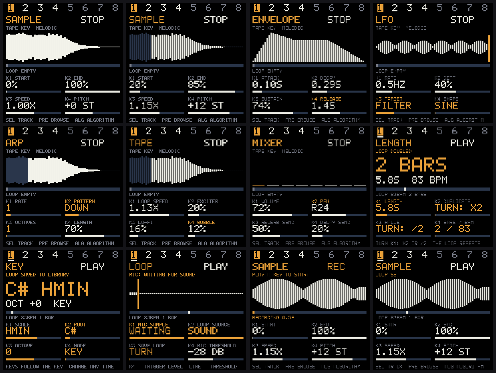
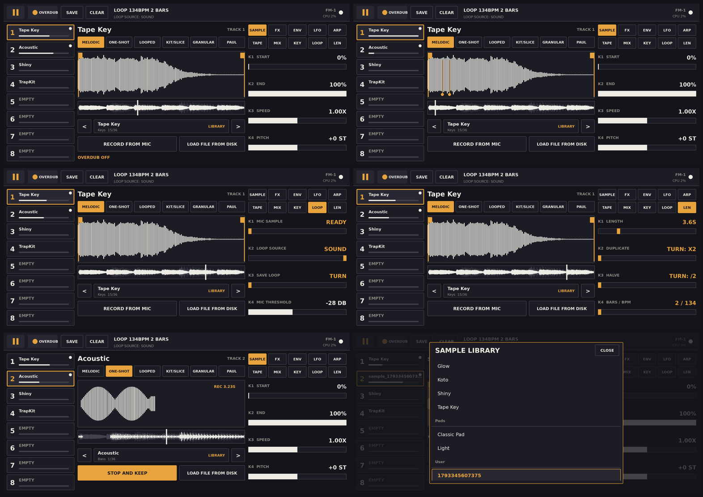

# fm1-sampler

A **sampler + audio looper** (8 tracks) for Android with the M-VAVE FM-1 as its hardware front end. The phone does all the sound; the FM-1 is the
control surface (keys, buttons, 7 encoders), the second screen (240x240, drawn with SysEx commands) and the audio output (USB audio).
All DSP is original code in `engine/dsp` (no third-party audio engine); the only library is KissFFT (BSD) for the Paulstretch mode.

## Screenshots
FM-1 second screen (240x240, from the host simulator `app_sim`: sample, edit, envelope, LFO, arp, tape, mixer, loop length, key, mic waiting, rec armed, loop playing):

Phone app (sample with voice positions and the whole-loop lane, voices, LOOP page, LENGTH page, mic recording, library):

## Downloads
APK and the flash page of the matching firmware are attached to the [releases](../../releases) of this repository. Flash the firmware first (SEL = loop length page needs it), then install the APK.

## FM-1 controls
| Control | Does |
|---|---|
| SELECT (encoder 0) | track 1..8 |
| PRESETS (encoder 6) | browses the sample library; after 250 ms of rest the entry is loaded on the selected track and played (audition) |
| ALGORITHM (encoder 1) | MELODIC, ONE-SHOT, LOOPED, KIT/SLICE, GRANULAR, PAULSTRETCH (the Sampler's MODE; KIT slices on transients, equal parts if there are none) |
| K1..K4 (encoders 2..5) | the four parameters of the current page (below) |
| HOME | sample: START, END, SPEED (time stretch 0.25..4x), PITCH (+-24 st). Speed and pitch are offline stretches, applied 350 ms after the knob rests |
| FX | REVERB SIZE, REVERB D/W (return level), DELAY TIME, DELAY FEEDBACK (global sends; per-track send levels are on MIXER) |
| ENV | ATTACK, DECAY, SUSTAIN, RELEASE of the selected track |
| LFO | RATE (0.1..20 Hz), DEPTH, TARGET (PITCH, FILTER, VOLUME, PAN), SHAPE (SINE, TRI, SQUARE, S&H) |
| ARP | RATE (OFF, 1..64 with triplets), PATTERN, OCTAVES, LENGTH (own arpeggiator on the tempo grid, free running) |
| SEQ ("TAPE") | LOOP SPEED (0.25..2x tape-style varispeed of the loop, GLOBAL for all tracks), EXCITER (cassette saturation), LO-FI (bit crush + hiss + dark tone), WOBBLE |
| EDIT | mixer of the selected track: VOLUME, PAN, REVERB SEND, DELAY SEND |
| GLO | key and scale: SCALE, ROOT, OCTAVE, MODE (KEY/CHORD). Drives the firmware's key mapping (SysEx 06) |
| SAVE | page LOOP. Tap = save the loop of the selected track into the library, hold 0.7 s = clear ALL loops (every track), also the phone CLEAR button. Knobs: MIC SAMPLE, LOOP SOURCE, SAVE LOOP, MIC THRESHOLD (-46..-6 dB, level that starts a mic take; used by mic sampling and mic loop source) |
| PLAY | play / stop |
| REC | clean looper: arms the first take (it starts with the first key or sound and sets the loop length and tempo; REC again ends it). Loop exists: toggles overdub on the selected track |
| SEL (the button after FX; index 3, the protocol and the firmware call it SCL) | page LENGTH: K1 LENGTH (turn up = loop x2 with its content repeated, down = /2), K2 DUPLICATE, K3 HALVE, K4 bars/bpm (read-only). Needs the firmware built here (`firmware/FM1-Sampler-Workbench.html`): it forwards SCL as button 3 and has no scale screen; the stock/fm1-daw firmware keeps SCL local |
| OCT -/+ | handled by the firmware (octave) |
| keys | KIT algorithm: all 27 keys are pads (note 60 + key, 16 slices repeat over the keys), every key lit, tonality and octave ignored. Otherwise the firmware is kept on a plain chromatic keyboard (scale OFF, SysEx 06 always sends 7; notes 53+key) so keys outside the tonality still play; the app adds the octave, builds triads itself in CHORD mode and lights ONLY keys that belong to the scale (root of each octave blinks; scale OFF: only roots); a sounding key goes dark. |

## Sample sources
- **Bundled library** (`samples/`, packed into the APK assets, copied to `files/samples` once): Bass, Drums (loaded as KIT), Keys, Pads.
- **Microphone**: phone button "RECORD FROM MIC" or LOOP page K1. Waits for sound above the trigger level, trims and normalises, saves `sample_<ms>.wav` in the data dir, loads it on the track it was started on.
- **Disk**: phone button "LOAD FILE FROM DISK" -> system picker -> `AudioImport.java` converts to a 16-bit WAV (`sample_<name>.wav` in `files/`): WAV 8/16/24/32/float directly, anything else through MediaCodec (mp3, aac, ogg, flac). Max 90 s.
- **Saved loops** and the two above all live in the "User" group of the library (`sample_*.wav` in the data dir).
Browsing replaces the sample of the selected track; a new sampler keeps the track's settings (`applyAll` after `sampleVersion` bumps).
At start: Tape Key on track 1, Acoustic bass on 2, Shiny on 3, TrapKit (KIT) on 4.

## Looper details
- Loop source (LOOP page K2, or the label in the phone top bar): SOUND = what the track plays (keys, arp, sample, filter, before the cassette) or MIC. Default SOUND.
- One clip per track; all tracks share the loop length of the first take. All loops are read (and recorded) through ONE tape pointer (`Session::tapePos`), so LOOP SPEED moves them together. At 1.0x the pointer is locked to the transport.
- Recording into the loop works at any speed like a tape head: below 1x the input is spread over the two neighbouring cells weighted by the speed, above 1x the skipped cells are filled by interpolating the input.
- A free take records audio only (no notes), so nothing in the loop runs at a speed of its own.
- Exciter / lo-fi / wobble are global: a per-track cassette (saturation, tone, wow and flutter, hiss, mix) followed by a bit crusher.
- Reverb and delay run 100 % wet as send returns; D/W is the return gain (`Session::setRetLevel`).
- The whole-loop overview in the phone UI (`Session::loopPeaks`) is refreshed by the audio thread, 8 of 400 bins per block.

## Engine
- `engine/dsp/Sampler.*`: the instrument. Up to 8 voices; MELODIC, ONE-SHOT, LOOPED (crossfaded loop), KIT (16 slices cut at the hits by `Slicer.h`, pad = note - 60), GRANULAR (Hann grains at random positions in the window), PAUL (`Paul.*`: windowed spectra with random phases, overlap-add, at most 4 voices). `Adsr.h`, `Filter.h` (state variable low-pass, used by the LFO filter target).
- `engine/dsp/Stretch.*`: offline time stretch (WSOLA) and pitch shift (stretch + resample) of the sample window; built on the worker thread 350 ms after the SPEED / PITCH / START / END knob rests, then swapped in.
- `engine/dsp/Reverb.h` (8 combs + 4 allpasses per side), `TapeDelay.h`, `TapeInsert.h`, `Arp.h` (UP, DOWN, UPDN, CONV, RAND over 1..4 octaves, sample accurate gate), `Wav.*`.
- `engine/session/Session.*`: tracks, mixer, LFO (once per block, ~170 Hz: pitch, filter, volume or pan), looper, mic recorder, library listing, command queue to the audio thread, worker thread. `status()` is lock-free.
- `engine/app/SamplerApp.*`: all behaviour: knob pages (`knobs(Page)` is the single source for FM-1 and phone), per-track state, library, looper, FM-1 screen drawing and LEDs, SysEx pacing and loss recovery.
- `engine/ui/SamplerUI.*`: the phone UI as draw ops (left tracks, centre sample/waveform with draggable START/END, voice markers, whole-loop lane, right page tabs + 4 sliders, library sheet). `ui/UiOp.h`, `Theme.h` (paper/ink/amber, square corners).
- `android/`: `Backend` (FM-1 USB MIDI + USB audio routing, Oboe, 30 Hz tick), `SamplerActivity` (file picker, mic permission), `AudioImport`, `SamplerView` (replays ops), `native-lib.cpp`. Package `com.ferluht.fm1sampler`, lib `fm1sampler`.
- `firmware/`: the FM-1 firmware (M-VAVE's open firmware with the control-surface protocol of `PROTOCOL.md`). `firmware/FM1-Sampler-Workbench.html` is the flash page; `tools/build_fw.py firmware ~/fm1/wine/drive_c/JL/pi32` rebuilds it (JieLi toolchain under wine, ~30 s). Changes in `app/ctrl.c`: SEL (BTN_SCL) forwarded to the app (no on-device scale screen), splash "SAMPLER".

## Build and test
- Host: `make -C engine -j4`, then `make $PWD/engine/build/<t>` with t = `test_app` (checks: every algorithm, LFO targets, stretch and pitch, tape, arp, loop, speed, overdub, loop length, voices, KIT keys, save/clear, mic, disk import, audition, DSP units), `app_sim` (virtual FM-1, writes `app_NN_*.ppm` screenshots of its screen), `phone_render` + `python3 engine/tools/render_ui.py ui_ops.json outdir 1.5` (phone screenshots), `probe` (what the default project loads). Paths in the tools assume `~/fm1-sampler/samples`. The tools sleep a little per audio block so the worker thread (sample loading) keeps up with the simulated time.
- Android: `cd android && ANDROID_HOME=~/android-sdk ~/gradle/gradle-8.9/bin/gradle assembleDebug -q` (~4 min first, never edit engine sources while it compiles: clang then reports "source file is not valid UTF-8"). Output `app/build/outputs/apk/debug/app-debug.apk`.

## Status
Host-tested only (test_app all green, screenshots of both screens checked). **Not run on a phone or an FM-1.** Open questions: MediaCodec import on a real phone, offline stretch time on the phone CPU, Paulstretch / granular CPU on the phone, arp is free running (not locked to the loop), loop clips are not saved with a project (no project save/load).
